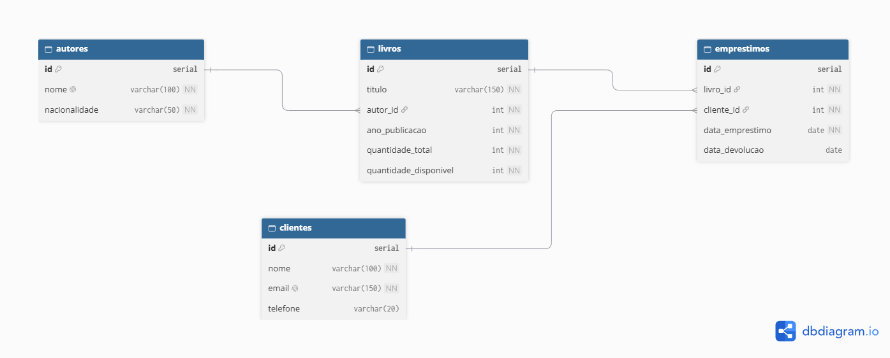

# BookStore Manager CLI

Aplicação de linha de comando para gerenciar uma pequena livraria: autores, livros, clientes e empréstimos.

## Objetivo

O BookStore Manager CLI pode ser usado para o controle de uma livraria. Pelo terminal, é possivel cadastrar autores, livros e clientes, registrar empréstimos e devoluções, com validações para evitar erros, como emprestar um livro sem exemplares disponíveis.

## Tecnologias utilizadas

- Node.js
- TypeScript
- PostgreSQL (projeto do banco, modelado em SQL)
- Git e GitHub

## Requisitos para execução

- Node.js (v24.18.0)
- npm
- PostgreSQL (para executar o `script.sql`)

## Instalação

```bash
git clone https://github.com/devMcouto/bookstore-manager-cli.git
cd bookstore-manager-cli
npm install
```

## Execução

```bash
npm run dev      # modo desenvolvimento
npm run build    # compila para a pasta dist
npm start        # executa a versão compilada
```

## Banco de dados

A aplicação não se conecta ao banco: os dados ficam em memória. O banco é um projeto à parte, na pasta `database/`.

### Executando o script SQL

1. Crie um banco vazio, por exemplo `bookstore`.
2. Execute o arquivo `database/script.sql` (no pgAdmin, pelo Query Tool, ou pelo `psql`):

```bash
psql -U postgres -d bookstore -f database/script.sql
```

O script cria as tabelas, insere os dados de exemplo, mostra exemplos de UPDATE e DELETE e traz os relatórios.

### Diagrama Entidade-Relacionamento (DER)



## Arquitetura do projeto

A aplicação é dividida em camadas, cada uma com uma responsabilidade. O fluxo de uma funcionalidade segue uma ordem: Menu -> Controller -> Service -> Repository.

- **Menus:** mostram as opções no terminal e chamam o método certo do Controller.
- **Controllers:** Interage com o usuário perguntando dados, exibindo mensagens e erros, assim acionando os Services.
- **Services:** Neles estão as regras de negócio, validam os dados, verificam se autor,livro ou cliente existem, se o livro está disponivel, e lançam erros claros quando algo é inválido.
- **Repositories:** Responsável por guardar e buscar os dados em memória (utilizando `Map`). Os métodos são `async`, prontos para uma futura integração com banco.
- **Models:** Classes e interfaces que representam as entidades (`Autor`, `Livro`, `Cliente`,`Emprestimo`).
- **Utils:** Funções reutilizáveis, como validações, formatação de datas, leitura do terminal e a classe de erro `AppError`.
- **Data(seed):** Dados iniciais carregados ao iniciar a aplicação.
- **Database:** DER e `script.sql`, fora de `src/`, sem conexão com a aplicação.

O arquivo `main.ts` apenas cria as instâncias, carrega o seed e abre o menu principal.

## Funcionalidades implementadas

- CRUD de autores, livros e clientes
- Realização de empréstimos e devoluções
- Listagem de empréstimos (todos e ativos)
- Validações: autor, livro, cliente e empréstimo inexistentes, livro indisponível e registros duplicados
- Dados iniciais (seed) carregados ao iniciar

## Estrutura de pastas

```
bookstore-manager-cli/
├── database/
│   ├── DER.png
│   └── script.sql
├── src/
│   ├── controllers/
│   │   ├── AutorController.ts
│   │   ├── ClienteController.ts
│   │   ├── EmprestimoController.ts
│   │   └── LivroController.ts
│   ├── data/
│   │   └── seed.ts
│   ├── menus/
│   │   ├── AutorMenu.ts
│   │   ├── ClienteMenu.ts
│   │   ├── EmprestimoMenu.ts
│   │   ├── LivroMenu.ts
│   │   └── MenuPrincipal.ts
│   ├── models/
│   │   ├── Autor.ts
│   │   ├── Cliente.ts
│   │   ├── Emprestimo.ts
│   │   ├── EmprestimoDetalhado.ts
│   │   ├── IEntidade.ts
│   │   ├── Livro.ts
│   │   └── LivroDetalhado.ts
│   ├── repositories/
│   │   ├── AutorRepository.ts
│   │   ├── BaseRepository.ts
│   │   ├── ClienteRepository.ts
│   │   ├── EmprestimoRepository.ts
│   │   ├── IRepository.ts
│   │   └── LivroRepository.ts
│   ├── services/
│   │   ├── AutorService.ts
│   │   ├── ClienteService.ts
│   │   ├── EmprestimosService.ts
│   │   └── LivroService.ts
│   ├── utils/
│   │   ├── AppError.ts
│   │   ├── exibirErro.ts
│   │   ├── formatacao.ts
│   │   ├── Input.ts
│   │   └── Validacoes.ts
│   └── main.ts
├── .gitignore
├── package.json
├── package-lock.json
├── README.md
└── tsconfig.json
```

## Exemplos de utilização

```
=== BOOKSTORE MANAGER CLI ===
1 - Autores
2 - Livros
3 - Clientes
4 - Empréstimos
0 - Encerrar aplicação
Escolha: 1

        === AUTORES ===
    1 - Cadastrar autor
    2 - Listar autores
    3 - Consultar autor por ID
    4 - Atualizar autor
    5 - Remover autor
    0 - Voltar

Escolha: 2
--- Autores ---
[1] Machado de Assis (Brasileira)
[2] Clarice Lispector (Brasileira)
[3] George Orwell (Britânica)

        === AUTORES ===
    1 - Cadastrar autor
    2 - Listar autores
    3 - Consultar autor por ID
    4 - Atualizar autor
    5 - Remover autor
    0 - Voltar

Escolha: 1
Nome: Matheus Lispector
Nacionalidade: Brasileiro
Autor cadastrado com ID 4.

        === AUTORES ===
    1 - Cadastrar autor
    2 - Listar autores
    3 - Consultar autor por ID
    4 - Atualizar autor
    5 - Remover autor
    0 - Voltar

Escolha: 0

=== BOOKSTORE MANAGER CLI ===
1 - Autores
2 - Livros
3 - Clientes
4 - Empréstimos
0 - Encerrar aplicação
Escolha: 2

=== LIVROS ===
1 - Cadastrar livro
2 - Listar livros
3 - Consultar livro por ID
4 - Atualizar livro
5 - Remover livro
0 - Voltar
Escolha: 1
Título:A Arte do typescript
ID do autor: 4
Ano de publicação: 2026
Quantidade de exemplares: 1
Livro cadastrado com ID 5.

=== LIVROS ===
1 - Cadastrar livro
2 - Listar livros
3 - Consultar livro por ID
4 - Atualizar livro
5 - Remover livro
0 - Voltar
Escolha: 2
--- Livros ---
[1] Dom Casmurro - Machado de Assis (1899) | Disponíveis: 2/3
[2] Memórias Póstumas de Brás Cubas - Machado de Assis (1881) | Disponíveis: 2/2
[3] A Hora da Estrela - Clarice Lispector (1977) | Disponíveis: 1/2
[4] 1984 - George Orwell (1949) | Disponíveis: 4/4
[5] A Arte do typescript - Matheus Lispector (2026) | Disponíveis: 1/1
```

## Integrantes

- Matheus Monteiro Couto

## Kanban

([link do quadro](https://github.com/users/devMcouto/projects/2/views/1))
